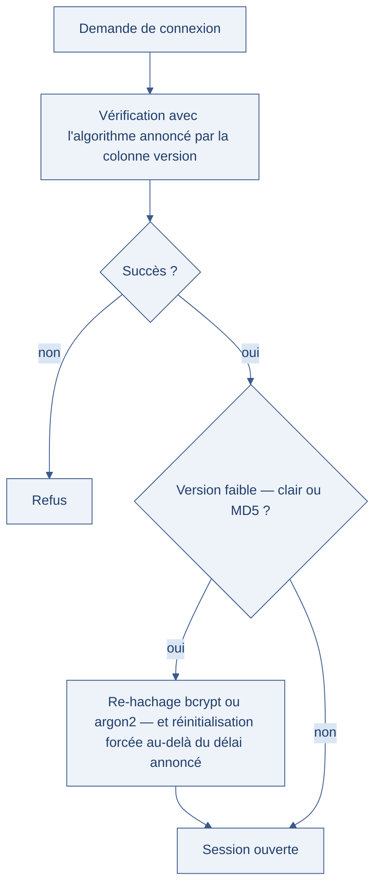

[← Chapitre précédent](01-authentifier-nest-pas-autoriser.md) · [Sommaire](Readme.md) · [Chapitre suivant →](03-sessions.md)

# Mots de passe — hacher, saler, policer

> En 2012, LinkedIn perd **117 millions** de mots de passe, stockés en SHA-1
> **sans sel** — un algorithme de la famille SHA (Secure Hash Algorithm). Des
> années plus tard, ces secrets ressortent dans des listes revendues — et comme
> beaucoup de personnes
> réutilisent leurs mots de passe, la brèche se propage bien au-delà : webmail,
> banque, plateforme de données. Un stockage négligé ne se répare jamais tout à
> fait.

**Durée :** ≈ 23 min — lecture ≈ 15 min + atelier 8 min · **Prérequis :** [Authentifier n'est pas autoriser](01-authentifier-nest-pas-autoriser.md)

> 📖 Vocabulaire et acronymes : [glossaire du cours](A-Glossaire-et-ressources.md).

---

## Objectifs

À l'issue de ce chapitre, vous serez capable de :

- **Expliquer** pourquoi un mot de passe stocké en clair ou haché avec MD5 (Message Digest 5) expose tous les comptes.
- **Choisir** un algorithme de hachage adapté — bcrypt ou argon2 — et justifier le rôle du sel et du coût.
- **Appliquer** les recommandations du NIST (National Institute of Standards and Technology) 800-63B à une politique de mots de passe.
- **Auditer** un stockage de mots de passe existant et proposer une migration progressive.

---

## I. Ce qu'il ne faut pas faire

Un mot de passe est un secret : le serveur n'a besoin que de **vérifier** qu'on le
connaît, jamais de le relire. Trois stockages se rencontrent encore dans les
applications existantes, du plus grave au moins grave.

### Le secret en clair

La base contient le mot de passe lui-même. Quiconque lit la base — administrateur,
sauvegarde volée, injection SQL (Structured Query Language) — lit tous les
secrets. Et comme les personnes réutilisent leurs mots de passe, la brèche
déborde largement sur l'application.

> ⛔ **Piège de sécurité**
> Un support technique qui « lit le mot de passe pour dépanner » prouve que le
> stockage est en clair. Personne, jamais, ne doit pouvoir relire un mot de passe
> — y compris l'administrateur de la base.

### Le hachage sans sel : MD5, SHA-1

Le **hachage** transforme le secret en une empreinte de longueur fixe, que l'on ne
peut pas revenir en arrière. Suffisant ? Non : MD5 (Message Digest 5) et SHA-1
sont **rapides**, et un hachage rapide se devine vite.

Le pire est l'absence de **sel** — une donnée aléatoire ajoutée avant le hachage.
Sans lui, le même mot de passe donne toujours la même empreinte. Les attaquants
préparent alors des **tables arc-en-ciel** (rainbow tables) : des milliards
d'empreintes déjà calculées pour les mots de passe courants. Une recherche dans la
table, et l'empreinte redevient un mot de passe.

> 🧪 **Atelier rapide (8 min)**
>
> La base de démonstration du lab contient des stockages de toutes les époques.
> Lab démarré (`cd lab-securite && docker compose up --build -d`), listez les secrets
> stockés :

```bash
docker exec -it lab-db mysql -uroot -proot fromagerie \
  -e "SELECT username, password_hash FROM users;"
```

> Trois observations : le compte `alice` affiche son mot de passe **en clair** ;
> le compte `charlie` affiche une empreinte de 32 caractères ; les comptes `zoe`
> et `marc` affichent une chaîne qui commence par `$2b$`. D'où vient l'empreinte
> de `charlie` ? Calculez :

```bash
echo -n "password" | md5sum
```

> L'empreinte calculée est celle stockée. N'importe qui peut refaire ce calcul sur
> un dictionnaire entier de mots de passe courants — c'est exactement ce que font
> les tables arc-en-ciel.

### Ce que ça donne en pratique

| Stockage | Ce que voit l'attaquant | Récupération du secret |
| --- | --- | --- |
| Clair | le mot de passe | immédiate |
| MD5 ou SHA-1 sans sel | l'empreinte | secondes à heures, matériel grand public |
| MD5 avec sel | l'empreinte et le sel | toujours rapide : le sel empêche la précalculaison, pas la devinette |
| bcrypt ou argon2 | l'empreinte, le sel, le coût | coûteuse : chaque tentative demande du temps ou de la mémoire |

---

## II. Hachage adapté : bcrypt, argon2

Un algorithme de hachage de mots de passe doit être **lent, volontairement** : la
lenteur ne gêne pas le serveur (une vérification par connexion) mais ruine
l'attaquant (des milliards de tentatives).

- **bcrypt** (1999) intègre le sel dans l'empreinte et un **coût** (work factor)
  qui double le temps de calcul à chaque cran. L'empreinte stockée contient tout
  ce qu'il faut pour vérifier : `$2b$12$…` annonce la version, le coût `12`, puis
  le sel et l'empreinte.
- **argon2** (2015, lauréat de la Password Hashing Competition) ajoute la
  **mémoire** au calcul : chaque tentative consomme de la **RAM** (mémoire
  vive), ce qui rend l'attaque par matériel spécialisé — les GPU (processeurs
  graphiques) ou les circuits dédiés — bien plus coûteuse. C'est le choix
  recommandé pour un nouveau projet.

### Le rôle du sel

Le sel est unique par mot de passe et stocké avec l'empreinte. Son effet :

```text
mot de passe : « hiver-2026 »

  sel 4f2a91c3…  ──►  bcrypt (coût 12)  ──►  $2b$12$4f2a…Q7
  sel 9c81d70b…  ──►  bcrypt (coût 12)  ──►  $2b$12$9c81…X2
```

Deux comptes qui choisissent le même mot de passe n'ont pas la même empreinte :
plus de table arc-en-ciel précalculable, et une attaque doit être relancée compte
par compte.

### Vérifier, côté serveur

```python
import bcrypt

# À l'inscription : le sel est généré par bcrypt, inclus dans l'empreinte.
empreinte = bcrypt.hashpw(mot_de_passe.encode(), bcrypt.gensalt(rounds=12))

# À la connexion : une seule comparaison, jamais de re-hachage partiel.
if bcrypt.checkpw(mot_de_passe.encode(), empreinte):
    ouvrir_la_session()
```

> ⚠️ **Attention**
> Ne stockez pas le sel dans une colonne séparée « par sécurité » : bcrypt et
> argon2 le gèrent eux-mêmes. Et ne comparez jamais deux empreintes avec une
> boucle maison — la comparaison doit être **à temps constant**, ce que font les
> bibliothèques.

### Migrer un stockage existant

Une application ancienne ne se met pas à jour en un jour. La migration
transparente classique : à la **prochaine connexion réussie**, re-hacher le mot de
passe avec l'algorithme moderne et remplacer l'empreinte — l'utilisateur ne voit
rien. On garde une colonne de « version de hachage » pour savoir où en est chaque
compte, et on force la réinitialisation des empreintes les plus faibles (clair,
MD5) après un délai annoncé.

Le schéma ci-dessous montre pourquoi la bascule n'est possible que sur une vérification réussie : on ne peut pas re-hacher ce qu'on ne peut pas relire.



---

## III. Politique et NIST 800-63B

Le stockage ne suffit pas : la **politique** décide de ce que les personnes peuvent
choisir, et de ce que l'application refuse. Les recommandations du NIST (document
SP 800-63B) ont inversé plusieurs habitudes anciennes :

| Ancienne habitude | Recommandation NIST 800-63B | Pourquoi |
| --- | --- | --- |
| Imposer majuscule, chiffre et symbole | Exiger la **longueur**, accepter les phrases de passe | les règles de complexité produisent des motifs prévisibles |
| Forcer le changement tous les trimestres | Ne changer **qu'en cas de suspicion** de compromission | la rotation forcée fait incrémenter le même mot de passe |
| Interdire le copier-coller | L'accepter | il favorise les gestionnaires de mots de passe |
| Questions secrètes (« le nom de votre animal ? ») | Les supprimer | les réponses se trouvent sur les réseaux sociaux |
| Longueur maximale très courte | Accepter au moins 64 caractères | les phrases de passe longues sont mémorisables et robustes |

Deux obligations ne changent pas :

- **Refuser les mots de passe déjà fuités** : comparer la saisie, à l'inscription
  et à chaque changement, avec une liste de secrets connus (des listes publiques
  existent en version consultable hors ligne, sans envoyer le mot de passe à un
  tiers).
- **Limiter les tentatives** de connexion, par compte et par adresse source, sans
  transformer la limitation en déni de service contre la victime.

### La proportionnalité, encore

Un formulaire de commentaire public et la console d'administration d'une
plateforme de données n'appellent pas la même politique. Ce sont les données
exposées et l'impact métier qui décident du niveau attendu — pas une règle
uniforme appliquée partout. La friction a un coût : chaque contrainte ajoutée est
un motif d'abandon ou de contournement (mot de passe écrit sur un post-it).

> 💡 **Astuce**
> Test d'audit en une question : « comment vérifiez-vous un mot de passe ? ». Si
> la réponse contient une comparaison directe dans une requête SQL, le stockage
> est en clair ou mal haché.

---

## IV. Aller plus loin

*Ces approfondissements sont facultatifs : ils ne sont jamais exigés pour terminer
la journée.*

- **Les gestionnaires de mots de passe** : ils génèrent un secret unique par
  service, le stockent chiffré et le remplissent automatiquement. C'est la seule
  manière réaliste d'avoir un mot de passe différent partout — et cela réduit la
  question à un seul secret maître, à protéger avec une MFA (authentification
  multifacteur, chapitre [MFA et identité data](06-mfa-et-identite-data.md)).
- **Les phrases de passe** (passphrases) : trois mots ordinaires séparés battent
  un mot de passe court « complexe », en mémorabilité comme en résistance.
- **Le chiffrement des sauvegardes** : une base volée est un incident ; une base
  volée **et** mal hachée est une crise. Le hachage protège au repos, il ne
  remplace pas le contrôle d'accès à la base.

---

## Points clés

- Un mot de passe se **vérifie**, il ne se relit jamais : ni en clair, ni
  chiffré avec une clé que le serveur détient seul.
- MD5 et SHA-1, même salés, sont trop rapides : bcrypt et argon2 rendent chaque
  tentative **coûteuse** en temps ou en mémoire.
- Le **sel** annule les tables arc-en-ciel ; le **coût** règle la vitesse — à
  augmenter avec le matériel disponible.
- La politique suit le NIST 800-63B : **longueur** plutôt que complexité, pas de
  rotation forcée, mots de passe fuités refusés, tentatives limitées.

---

## 🧠 Vérifiez vos acquis

*Formatif, jamais noté. Répondez sans relire le chapitre. Les réponses se déplient juste après le séparateur : ce qui compte est de repérer où vous vacillez, pas de faire 5 sur 5.*

**1.** En 2012, LinkedIn perd 117 millions d'empreintes SHA-1 **sans sel**. Pourquoi l'absence de sel est-elle si grave ?

- A. SHA-1 produit une empreinte plus courte que MD5 : moins de combinaisons, elle se retrouve plus vite
- B. Sans sel, un même mot de passe donne toujours la même empreinte : les tables arc-en-ciel font le reste
- C. SHA-1 est un chiffrement réversible dès qu'on connaît la clé, et les clés des années 2000 sont publiques
- D. Le sel ralentit trop le serveur pour être généralisé : LinkedIn a préféré s'en passer pour tenir la charge

**2.** Dans la base du lab, le compte `charlie` porte une empreinte de 32 caractères, et `echo -n "password" | md5sum` redonne exactement cette valeur. De quel stockage s'agit-il ?

- A. Un bcrypt de coût 12
- B. Un argon2
- C. Un MD5 sans sel
- D. Un mot de passe stocké en clair

**3.** Pourquoi argon2 est-il le choix recommandé pour un nouveau projet ?

- A. Il produit une empreinte plus courte que bcrypt, la base reste petite et les vérifications plus rapides
- B. Il ajoute la mémoire au calcul : chaque tentative consomme de la RAM, ce qui renchérit l'attaque par GPU ou circuit dédié
- C. Il est plus rapide que bcrypt : le serveur vérifie plus vite et l'utilisateur attend moins longtemps
- D. Il rend le sel inutile, la mémoire consommée changeant à chaque tentative

**4.** Vous appliquez le NIST 800-63B. Lequel de ces comportements est le bon ?

- A. Vous forcez le changement de mot de passe tous les trimestres, pour qu'un secret fuité ait peu de temps pour servir
- B. Vous imposez majuscule, chiffre et symbole, pour rendre chaque mot de passe imprévisible malgré les dictionnaires
- C. Vous acceptez les phrases de passe longues et vous refusez les mots de passe déjà fuités
- D. Vous interdisez le copier-coller pour forcer la mémorisation et éviter que le secret soit recopié dans un fichier

**5.** *Question ouverte (2-3 lignes).* Votre application stocke encore des empreintes MD5 sans sel. Décrivez la migration transparente classique, et ce que vous réservez aux comptes les plus exposés.

---

<details>

<summary>Vérifier ses réponses</summary>

### Réponses

**1. B.** Sans sel, deux comptes qui choisissent le même mot de passe ont la même empreinte, et une empreinte connue se retrouve par recherche dans une table précalculée.
**Pourquoi :** le sel annule la précalculaison et oblige à relancer l'attaque compte par compte — il n'empêche pas la devinette, c'est le rôle du coût.

**2. C.** 32 caractères hexadécimaux et un calcul direct qui retombe sur la même valeur : c'est MD5 sans sel, donc devinable à partir d'un dictionnaire.
**Pourquoi :** une empreinte rapide se casse avec du matériel grand public, en secondes à heures — bcrypt ou argon2 auraient commencé par `$2b$` et annoncé leur coût.

**3. B.** La mémoire obligatoire rend l'attaque par matériel spécialisé coûteuse, là où bcrypt ne ralentit que le temps de calcul.
**Pourquoi :** un algorithme de mot de passe doit être lent volontairement : la lenteur gêne une vérification par connexion, pas des milliards de tentatives.

**4. C.** Longueur plutôt que complexité, phrases de passe acceptées, mots de passe déjà fuités refusés — et pas de rotation forcée, pas de questions secrètes, copier-coller accepté.
**Pourquoi :** les règles de complexité produisent des motifs prévisibles et la rotation trimestrielle fait incrémenter le même secret.

**5.** Attendu : à la prochaine connexion réussie, re-hacher le mot de passe avec bcrypt ou argon2 et remplacer l'empreinte, sans que l'utilisateur voie quoi que ce soit ; garder une colonne de version de hachage pour savoir où en est chaque compte ; forcer la réinitialisation des empreintes les plus faibles (clair, MD5) après un délai annoncé.
**Pourquoi :** on ne peut pas re-hacher ce qu'on ne peut pas relire — seule une connexion réussie redonne le secret le temps du remplacement.

</details>

---

[← Chapitre précédent](01-authentifier-nest-pas-autoriser.md) · [Sommaire](Readme.md) · [Chapitre suivant →](03-sessions.md)
