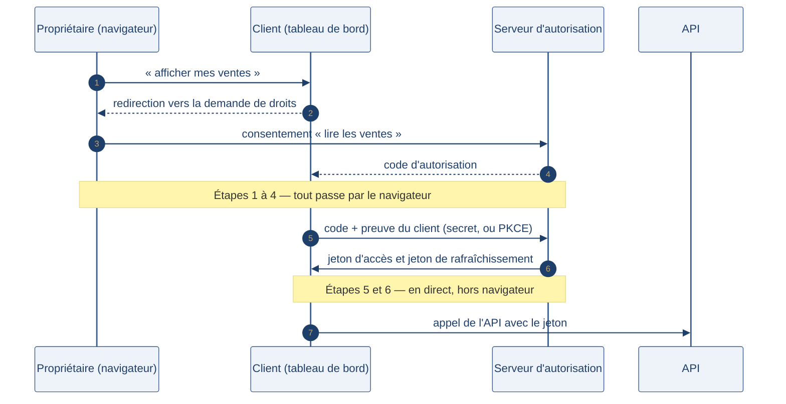

[← Chapitre précédent](04-jwt-et-tokens.md) · [Sommaire](Readme.md) · [Chapitre suivant →](06-mfa-et-identite-data.md)

# OAuth2 et OpenID Connect — donner un accès limité

> Avant OAuth, une application qui voulait accéder à vos photos vous demandait
> votre **mot de passe** — et se retrouvait avec tous vos droits, sans que vous
> puissiez rien lui retirer. OAuth2 (Open Authorization 2) inverse la logique : on
> ne partage pas son secret, on accorde un **accès limité** dans le temps et dans
> le périmètre. OpenID Connect ajoute par-dessus la réponse à « qui êtes-vous ? ».

**Durée :** ≈ 17 min — lecture ≈ 12 min + atelier 5 min · **Prérequis :** [JWT et tokens](04-jwt-et-tokens.md)

> 📖 Vocabulaire et acronymes : [glossaire du cours](A-Glossaire-et-ressources.md).

---

## Objectifs

À l'issue de ce chapitre, vous serez capable de :

- **Expliquer** le problème que résout OAuth2 : partage de mot de passe, permissions excessives, absence de révocation.
- **Décrire** le flow authorization code : acteurs, consentement, code, jeton d'accès.
- **Distinguer** l'autorisation (OAuth2) de l'authentification (OpenID Connect).
- **Choisir** entre clé d'API et jeton délégué selon le consommateur : humain, application, pipeline.

---

## I. Le problème

Une plateforme de business intelligence veut afficher les ventes d'un entrepôt de
données dans son tableau de bord. Solutions d'avant OAuth :

1. **Donner le mot de passe** de la base ou du compte. L'outil peut alors tout
   faire — y compris ce que personne n'a demandé. Et si le mot de passe change,
   tout casse.
2. **Ouvrir un compte dédié** avec un mot de passe partagé. Qui l'utilise
   réellement ? Impossible de le savoir, et la suppression du compte casse tout le
   monde.
3. **Copier les données** dans l'outil. La donnée se retrouve en double, hors de
   votre contrôle.

Le point commun : on confie un **secret global** là où on voudrait accorder un
**droit limité**. OAuth2 sépare les deux rôles — un serveur d'autorisation décide
qui a droit à quoi, l'API se contente de vérifier le jeton.

---

## II. Le flow authorization code

### Les quatre acteurs

| Acteur | Rôle | Exemple |
| --- | --- | --- |
| Propriétaire de la ressource | la personne qui accorde | la responsable des ventes |
| Client | l'application qui demande | le tableau de bord |
| Serveur d'autorisation | il distribue les jetons | le service d'identité de l'entreprise |
| Serveur de ressources | l'API protégée | l'API de l'entrepôt de données |

### Le déroulement

Le déroulement ci-dessous garde les sept étapes du flow, et l'ordre des flèches y dit ce qui change de canal : les étapes 1 à 4 passent par le navigateur, les étapes 5 et 6 sont un échange direct entre le client et le serveur d'autorisation.

L'idée centrale : le **code** d'autorisation transite par le navigateur, mais le
**jeton** est échangé directement entre le client et le serveur d'autorisation,
avec une preuve d'identité du client. Un code intercepté ne suffit pas.

> 🧪 **Atelier rapide (5 min)**
>
> Reprenez le déroulement ci-dessus, étape par étape, et notez qui parle à qui —
> navigateur, client, serveur d'autorisation, API :
>
> 1. à quelle étape le mot de passe de la responsable des ventes est-il utilisé ?
> 2. un code d'autorisation intercepté par un tiers permet-il d'appeler l'API ?
>    Justifiez en une phrase.
> 3. que doit afficher l'écran de consentement pour que l'accord soit éclairé ?
>
> Comparez vos réponses à ce critère : *ce que chaque acteur apprend à chaque
> étape, et ce qu'il pourrait en faire*.

### Les périmètres (scopes)

Le jeton d'accès porte des **périmètres** — des mots qui décrivent ce qui est
autorisé : `lecture:ventes`, `ecriture:expeditions`. Le consentement les affiche,
l'API les vérifie à chaque appel. Un jeton `lecture:ventes` ne débloque jamais
`ecriture:expeditions`, même volé.

### Trois sortes de jetons

| Jeton | À quoi il sert | Durée de vie typique |
| --- | --- | --- |
| Jeton d'accès (access token) | appeler l'API | courte — minutes à heures |
| Jeton de rafraîchissement (refresh token) | obtenir un nouveau jeton d'accès | plus longue, révocable |
| Jeton d'identité (ID token) | dire **qui** est l'utilisateur | courte — voir section III |

### Clé d'API ou jeton délégué ?

| | Clé d'API (API key) | Jeton délégué (OAuth2) |
| --- | --- | --- |
| Elle identifie | le programme appelant | la personne **et** le programme |
| Elle porte des droits | fixes, attachés à la clé | des périmètres, consentis |
| Elle se révoque | en supprimant la clé | jeton par jeton, sans casser le reste |
| Usage idéal | machine à machine, partenaire technique | accès délégué au nom d'un utilisateur |

Une clé d'API n'est **pas** un moyen d'authentifier une personne : elle prouve
qu'un programme est autorisé à appeler, pas qui est derrière.

La ligne « machine à machine » du tableau a un nom dans OAuth2 : le flow
**client credentials** (identifiants du client). Le programme s'authentifie
*en son propre nom* — avec son `client_id` et son secret — et reçoit un jeton
d'accès de durée courte et de périmètre (scope) limité, sans consentement
humain. C'est l'alternative moderne à la clé d'API brute : même usage (pipeline,
service à service), mais le jeton est périssable et révocable. Les comptes de
service du chapitre 6 en appliquent les règles.

---

## III. OpenID Connect — l'identité par-dessus l'autorisation

OAuth2 répond à « qu'est-ce que cette application a le droit de faire ? ». Il ne
répond pas à « qui est l'utilisateur ? » — et beaucoup d'applications ont essayé
de le deviner à partir du jeton d'accès. OIDC (OpenID Connect) formalise la
réponse : c'est une couche **au-dessus** d'OAuth2, pas un concurrent.

- Le client demande le périmètre `openid` ; en plus du jeton d'accès, il reçoit
  un **jeton d'identité** (ID token) — un JWT (JSON Web Token) signé.
- Ce jeton porte des déclarations : `sub` (l'identifiant de l'utilisateur),
  `email`, `iss` (l'émetteur), `aud` (le client destinataire), `exp`.
- C'est le mécanisme derrière les boutons « se connecter avec… » : votre
  fournisseur d'identité atteste de qui vous êtes, l'application n'a jamais vu
  votre mot de passe.

> ⚠️ **Attention**
> Un ID token n'est pas un jeton d'accès : il est fait pour être **lu par le
> client**, pas présenté à une API. Et comme tout JWT, il se vérifie — signature,
> `iss`, `aud`, `exp` — avant de faire confiance à son contenu.

### Le cas du tableau de bord

Pour notre plateforme de business intelligence, la séparation devient nette :

- les **personnes** se connectent via OIDC avec l'identité de leur entreprise —
  le tableau de bord sait qui consulte quoi, et le départ d'une personne coupe
  son accès au même moment ;
- le **tableau de bord** appelle l'API avec un jeton d'accès à périmètre
  `lecture:ventes` ;
- l'**API** ne vérifie ni mot de passe ni identité : elle vérifie le jeton et ses
  périmètres.

---

### Exercice 1 — Concevoir l'authentification d'une API de données (55 min)

#### Contexte

Un opérateur logistique met en place une **API de données** qui expose ses
indicateurs : `/stocks`, `/ventes`, `/expeditions`. Trois consommateurs se
présentent :

1. **L'ERP (Enterprise Resource Planning) d'un partenaire** — un logiciel de gestion qui synchronise ses propres
   stocks avec ceux de l'opérateur. Personne ne l'utilise directement : il tourne
   tout seul.
2. **Un tableau de bord web** utilisé par les équipes du partenaire pour suivre
   les expéditions en temps réel. Les utilisateurs ont déjà une identité dans
   l'entreprise du partenaire (annuaire unique).
3. **Les pipelines internes de la plateforme data** de l'opérateur — des
   traitements d'automatisation qui lisent l'API pour alimenter l'entrepôt de
   données, et y déposent des agrégats.

Contraintes validées avec la direction :

- l'ERP synchronise ses données **une fois par nuit** ;
- le tableau de bord est utilisé **8 heures par jour** par les équipes ;
- les pipelines internes s'exécutent **toutes les heures** ;
- un accès compromis doit pouvoir être révoqué en **moins de 15 minutes** ;
- aucune clé en clair dans le code : les secrets sont stockés dans un coffre,
  injectés à l'exécution ;
- tout passe par HTTPS (HyperText Transfer Protocol Secure) et chaque appel est
  journalisé avec l'identité appelante.

---

#### Consignes

##### Partie 1 — Cartographier les acteurs

Pour chacun des trois consommateurs, identifiez les quatre acteurs du chapitre :
propriétaire de la ressource, client, serveur d'autorisation, serveur de
ressources. Précisez pour qui parle le jeton — une personne, un programme, ou les
deux.

##### Partie 2 — Choisir le mécanisme

Proposez, pour chaque consommateur, le mécanisme d'authentification retenu
(authorization code, OpenID Connect, client credentials, compte de service avec
clé, etc.) et justifiez votre choix en deux ou trois lignes. Un même mécanisme
peut servir à plusieurs consommateurs — dites pourquoi.

##### Partie 3 — Définir les jetons

Remplissez un tableau à cinq colonnes : consommateur, type de jeton, périmètres
(scopes), durée de vie, stockage côté client. Les durées de vie doivent respecter
les contraintes chiffrées du contexte — montrez comment.

##### Partie 4 — Contrôler côté serveur

Listez les contrôles que l'API applique à chaque requête, et décrivez la
procédure de révocation qui tient la promesse des **moins de 15 minutes**. Ajoutez
les signaux d'alerte qui trahissent un accès compromis.

---

#### ✅ Auto-évaluation

Avant de passer au corrigé, vérifiez que :

- [ ] Chaque consommateur a un mécanisme **choisi et justifié** — pas une solution unique plaquée sur les trois.
- [ ] Mes périmètres sont **aussi étroits que l'usage** : lire les stocks n'est pas écrire les expéditions.
- [ ] Mes durées de vie respectent les **contraintes chiffrées** du contexte, et je sais dire laquelle borne quoi.
- [ ] Aucun secret n'apparaît dans mon schéma côté client : je nomme **où** il vit et **comment** il arrive au programme.
- [ ] Ma révocation est **explicable en une procédure**, pas en un vœu (« il faudrait pouvoir couper »).

---

#### Prolongement de l'exercice

*Facultatif.* Le partenaire souhaite une version mobile du tableau de bord, sans
secret client embarqué. Quel mécanisme ajoutez-vous, et quelle menace spécifique
couvre-t-il ? Reliez votre réponse à la section « Aller plus loin » du chapitre.

Voir la correction

> Comparez d'abord votre travail aux **étapes** ci-dessous : la méthode compte
> autant que le résultat. Plusieurs schémas se défendent — ce qui est attendu,
> c'est que chaque choix soit **justifié par une contrainte du contexte**.

---

#### Partie 1 — Cartographier les acteurs

**Éléments attendus :**

| Consommateur | Propriétaire de la ressource | Client | Serveur d'autorisation | Serveur de ressources | Pour qui parle le jeton |
| --- | --- | --- | --- | --- | --- |
| ERP (Enterprise Resource Planning) du partenaire | l'opérateur logistique (le donneur d'ordre) | l'ERP | le serveur d'autorisation de l'opérateur | l'API de données | le **programme** (l'ERP), pas une personne |
| Tableau de bord web | chaque utilisateur du partenaire | l'application du tableau de bord | le fournisseur d'identité du partenaire | l'API de données | la **personne** derrière la session |
| Pipelines internes | la plateforme data de l'opérateur | chaque pipeline | le serveur d'autorisation interne | l'API de données | le **compte de service** du pipeline |

**Ce qu'il faut retenir :** la question « pour qui parle le jeton ? » décide de
tout le reste. Un jeton qui parle pour un programme ne porte pas de droits
délégués par une personne — et ne doit pas en porter.

**Erreurs fréquentes :** donner au ERP un jeton « au nom du responsable logistique
du partenaire ». Personne n'est derrière la synchronisation nocturne : prétendre
le contraire fabrique une identité qui n'existe pas, impossible à auditer.

---

#### Partie 2 — Choisir le mécanisme

**Éléments attendus :**

- **ERP du partenaire — client credentials.** Aucun utilisateur à représenter, un
  seul programme appelant : le flow authorization code n'apporterait rien. Le
  client s'authentifie auprès du serveur d'autorisation avec sa propre preuve et
  reçoit un jeton à périmètre borné.
- **Tableau de bord web — authorization code + OIDC (OpenID Connect).** Les
  utilisateurs ont déjà une identité chez le partenaire : OIDC la réutilise
  (annuaire unique), OAuth2 délègue l'accès à l'API sans jamais partager le mot
  de passe. Le départ d'une personne du partenaire coupe l'accès au même moment.
- **Pipelines internes — compte de service avec credential dédiée.** Pas de
  personne derrière, pas de MFA (authentification multifacteur) possible : chaque
  pipeline reçoit son propre compte, à périmètre minimal, avec une credential
  stockée dans le coffre de secrets et renouvelée automatiquement.

**Sur la cohérence :** les deux premiers passent par le même serveur
d'autorisation — c'est le troisième qui mérite un régime distinct, parce que sa
menace n'est pas l'hameçonnage mais la fuite de credential.

---

#### Partie 3 — Définir les jetons

**Éléments attendus** (une réponse équivalente, justifiée, est acceptée) :

| Consommateur | Type de jeton | Périmètres | Durée de vie | Stockage côté client |
| --- | --- | --- | --- | --- |
| ERP du partenaire | jeton d'accès + jeton de rafraîchissement | `lecture:stocks` | jeton d'accès court (minutes), rafraîchissement renouvelé à chaque synchronisation **nocturne** | coffre de secrets de l'ERP, jamais dans le code |
| Tableau de bord web | jeton d'accès OIDC + jeton de rafraîchissement | `lecture:stocks`, `lecture:expeditions` | couvre une journée de travail (**8 heures**) au maximum, puis reconnexion | cookie `HttpOnly` côté serveur, pas de `localStorage` |
| Pipelines internes | credential de compte de service, jeton court obtenu à l'exécution | `lecture:ventes` pour la lecture, `ecriture:agregats` pour le dépôt — **un périmètre par usage** | durée d'une exécution (**toutes les heures**), credential renouvelée par rotation | coffre de secrets, injectée à l'exécution |

**Comment les contraintes bornent les durées :** la promesse de révocation en
**moins de 15 minutes** interdit tout jeton longue durée sans contrôle — un jeton
d'accès qui vit des heures ne peut pas être coupé en minutes sans liste de
révocation. D'où des jetons d'accès courts, un rafraîchissement révocable, et une
liste noire vérifiée pour ce qui reste en circulation.

**Erreurs fréquentes :** une seule clé partagée par tous les pipelines « pour
simplifier » — l'incident devient alors total et l'audit impossible. Ou des
périmètres larges (`admin`, `*`) donnés « pour ne pas être bloqué ».

---

#### Partie 4 — Contrôler côté serveur

**Éléments attendus :**

Contrôles appliqués à chaque requête :

1. **Vérifier le jeton** — un JWT (JSON Web Token) : signature, algorithme en
   liste blanche, expiration, émetteur, destinataire (la liste du chapitre
   [JWT et tokens](04-jwt-et-tokens.md)).
2. **Vérifier le périmètre** — `lecture:stocks` ne débloque pas
   `ecriture:agregats`. C'est de l'autorisation, pas de l'authentification.
3. **Vérifier l'identité appelante** — le compte de service ou la personne
   rattachée au jeton, pour la journalisation.
4. **Limiter les appels** (rate limiting) par identité appelante : un pipeline qui
   se met à multiplier les requêtes est un signal.
5. **Journaliser** chaque appel : identité, périmètre, ressource, horodatage.

Procédure de révocation en **moins de 15 minutes** :

- supprimer ou faire tourner la credential du compte de service concerné (coffre
  de secrets, propagation immédiate à la prochaine exécution) ;
- révoquer le jeton de rafraîchissement du client concerné — les jetons d'accès
  en cours meurent seuls à leur expiration courte ;
- ajouter les jetons encore valides à la liste noire, vérifiée à chaque appel ;
- couper côté API si nécessaire : le périmètre du client est désactivé, tout
  appel est refusé même avec un jeton encore valide.

Signaux d'alerte d'un accès compromis : appel hors périmètre habituel, volume
anormal, exécution hors créneau (l'ERP qui se met à appeler en pleine journée),
tentatives répétées avec un jeton refusé.

**Ce qu'il faut retenir :** la révocation rapide se prépare **avant** l'incident.
Sans jetons courts ni liste noire, la promesse des **moins de 15 minutes** est
tenable uniquement en coupant le client entier — ce qui reste une option
d'urgence, pas une procédure.

---

#### Points à retenir

- Le mécanisme suit **pour qui parle le jeton** : personne (OIDC), programme
  (client credentials), pipeline (compte de service).
- Les périmètres bornent le jeton à l'usage réel ; un périmètre large annule le
  bénéfice de la délégation.
- Les durées de vie se déduisent des **contraintes opérationnelles** — ici la
  synchronisation nocturne, la journée de travail et la promesse de révocation.
- La révocation est un dispositif complet (credential, rafraîchissement, liste
  noire, coupure d'urgence), pas un bouton.

---

## IV. Aller plus loin

*Ces approfondissements sont facultatifs : ils ne sont jamais exigés pour terminer
la journée.*

- **PKCE** (Proof Key for Code Exchange) : les applications mobiles et les
  applications web riches ne peuvent pas garder de secret client. PKCE remplace le
  secret par une paire de valeurs aléatoires calculées à chaque connexion, ce qui
  neutralise l'interception du code d'autorisation. C'est aujourd'hui recommandé
  pour tous les clients, même ceux qui ont un secret.
- **La rotation des jetons de rafraîchissement** : chaque usage en délivre un
  nouveau et invalide l'ancien. Un jeton de rafraîchissement volé devient alors
  détectable — deux utilisations simultanées trahissent le vol.
- **Les jetons dans les URL** : jamais — la règle est détaillée au chapitre [JWT et tokens](04-jwt-et-tokens.md).
  Le jeton voyage dans un en-tête `Authorization`, sur HTTPS.

---

## Points clés

- OAuth2 sépare le **droit** (ce que l'application peut faire) du **secret** (votre
  mot de passe) : on accorde un accès limité, révocable, sans rien partager.
- Le flow authorization code fait transiter un **code** par le navigateur, et
  échange le **jeton** directement entre le client et le serveur d'autorisation.
- Les **périmètres** bornent le jeton ; l'API les vérifie à chaque appel — un
  jeton volé reste limité à ce qui a été consenti.
- OpenID Connect ajoute l'**identité** (ID token) à l'autorisation ; une clé
  d'API, elle, identifie un programme — jamais une personne.

---

## 🧠 Vérifiez vos acquis

*Formatif, jamais noté. Répondez sans relire le chapitre. Les réponses se déplient juste après le séparateur : ce qui compte est de repérer où vous vacillez, pas de faire 5 sur 5.*

**1.** Ce qu'OAuth2 change par rapport à « donnez-moi votre mot de passe » :

- A. Il chiffre le mot de passe avant de le confier à l'application, qui ne peut plus le relire
- B. Il accorde un droit limité dans le temps et dans le périmètre, sans partager le secret, et il est révocable
- C. Il supprime les mots de passe : l'application s'authentifie seule auprès de l'API
- D. Il centralise les mots de passe des applications dans un coffre commun dont l'accès est contrôlé

**2.** Un tiers intercepte le code d'autorisation qui transite par le navigateur. Peut-il appeler l'API ?

- A. Oui : le code vaut jeton d'accès, il suffit de le présenter à l'API en lieu et place du jeton
- B. Non : le jeton est échangé directement entre le client et le serveur d'autorisation, avec une preuve d'identité du client
- C. Oui, mais seulement si le consentement portait un périmètre d'écriture : un périmètre de lecture rend le code inoffensif
- D. Non : le code n'est jamais utilisable, pas même par le client légitime, qui doit redemander un code

**3.** Un jeton d'accès portant le périmètre `lecture:ventes` est volé. Que peut faire l'attaquant ?

- A. Tout : un jeton d'accès volé donne le compte complet, exactement comme un mot de passe volé
- B. Rien : le vol invalide le jeton, l'API refuse un même jeton présenté de deux endroits à la fois
- C. Lire les ventes uniquement — un jeton ne débloque jamais un périmètre qui n'a pas été consenti
- D. Écrire les expéditions, mais pas les supprimer : un jeton volé hérite des droits voisins de ceux consentis

**4.** Votre tableau de bord doit savoir **qui** consulte, en s'appuyant sur l'identité de l'entreprise, sans jamais voir les mots de passe. Qu'est-ce qui apporte cette réponse ?

- A. Un jeton d'accès OAuth2 avec un périmètre plus large, qui livrerait aussi l'identité de la personne
- B. Le code d'autorisation, que le tableau de bord relit pour reconnaître l'utilisateur connecté
- C. Le jeton d'identité (ID token) d'OpenID Connect, reçu avec le périmètre `openid`
- D. Une clé d'API nominative délivrée à chaque utilisateur, qui identifie la personne derrière l'appel

**5.** *Question ouverte (2-3 lignes).* Une équipe veut brancher son outil de business intelligence sur l'entrepôt de données et propose un compte commun `bi_tool` avec un mot de passe partagé. Ce qui ne va pas, ce que vous proposez à la place, qui vérifie quoi.

---

Vérifier ses réponses

### Réponses

**1. B.** On ne partage plus son secret : le serveur d'autorisation décide qui a droit à quoi, l'API se contente de vérifier le jeton.
**Pourquoi :** un secret global ne se retire pas sans tout casser, alors qu'un jeton se révoque jeton par jeton.

**2. B.** Le code transite par le navigateur, mais le jeton s'échange directement entre le client et le serveur d'autorisation, avec une preuve d'identité du client.
**Pourquoi :** c'est tout l'intérêt du flow authorization code — un code intercepté ne suffit pas à obtenir le jeton.

**3. C.** Les périmètres bornent le jeton et l'API les vérifie à chaque appel : `lecture:ventes` ne débloque jamais `ecriture:expeditions`, même volé.
**Pourquoi :** un jeton volé reste limité à ce qui a été consenti — c'est ce que le partage de mot de passe ne permettait pas.

**4. C.** OIDC est une couche au-dessus d'OAuth2 : avec le périmètre `openid`, le client reçoit un ID token, JWT signé qui dit qui est l'utilisateur.
**Pourquoi :** OAuth2 répond « qu'a le droit de faire cette application ? », pas « qui est l'utilisateur ? » — et une clé d'API identifie un programme, jamais une personne.

**5.** Attendu : un compte partagé est un secret global — impossible de savoir qui l'utilise réellement, les droits sont excessifs et la suppression du compte casse tout le monde. À la place : le flow authorization code avec un périmètre `lecture:ventes` pour l'outil (jeton court, révocable), et OIDC pour que les personnes se connectent avec l'identité de leur entreprise. Le serveur d'autorisation décide des droits, l'API ne vérifie ni mot de passe ni identité mais le jeton et ses périmètres.
**Pourquoi :** OAuth2 sépare le droit du secret — on retire un accès sans toucher au mot de passe de personne.

---

[← Chapitre précédent](04-jwt-et-tokens.md) · [Sommaire](Readme.md) · [Chapitre suivant →](06-mfa-et-identite-data.md)
