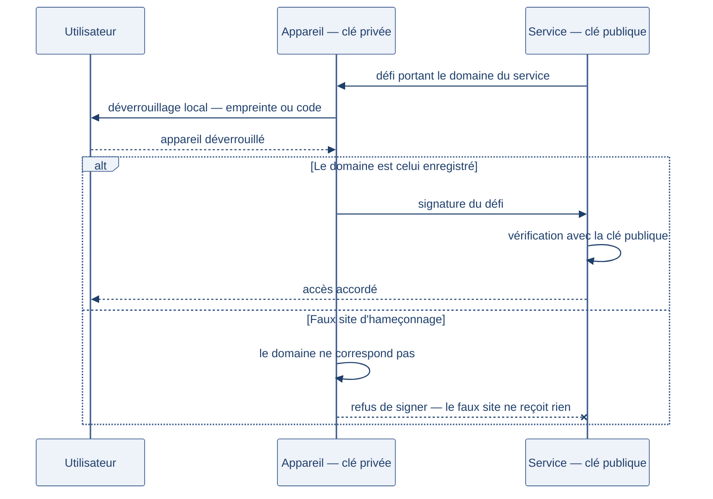

[← Chapitre précédent](05-oauth2-oidc.md) · [Sommaire](Readme.md) · [Chapitre suivant →](A-Glossaire-et-ressources.md)

# MFA et identité data — humains et machines

> Une administratrice de plateforme de données se connecte à l'entrepôt avec un
> mot de passe unique. Son pipeline d'automatisation, lui, utilise un compte de
> service avec une clé stockée dans un fichier de configuration. Lequel des deux
> est le plus dangereux ? La réponse dérange : le pipeline, lui, ne se fait pas
> hameçonner.

**Durée :** ≈ 19 min — lecture ≈ 14 min + atelier 5 min · **Prérequis :** [Authentifier n'est pas autoriser](01-authentifier-nest-pas-autoriser.md)

---

## Objectifs

À l'issue de ce chapitre, vous serez capable de :

- **Expliquer** ce que la MFA (authentification multifacteur) change — et ce qu'elle ne change pas.
- **Arbitrer** les facteurs d'authentification selon la population et la sensibilité des données, en tenant compte de l'accessibilité.
- **Distinguer** une identité humaine d'une identité de service, et leurs règles respectives.
- **Encadrer** un compte de service : périmètre minimal, stockage des secrets, rotation, journalisation.

---

## I. La MFA (authentification multifacteur)

### Ce que ça change

Le chapitre [Authentifier n'est pas autoriser](01-authentifier-nest-pas-autoriser.md)
a classé les preuves d'identité en trois familles : ce qu'on **sait**, ce qu'on
**a**, ce qu'on **est**. La **MFA** (authentification multifacteur) exige des
preuves de **familles différentes** — un mot de passe et un code sur le téléphone,
pas deux mots de passe.

Effet : le vol d'une preuve ne suffit plus. Un mot de passe fuité reste inutilisable
sans le second facteur ; un téléphone volé ne se combine pas avec un mot de passe
inconnu.

| Second facteur | Famille | Ce qu'il apporte | Sa faiblesse |
| --- | --- | --- | --- |
| Code par SMS (Short Message Service) | ce qu'on a | universel, aucun matériel | interception du message, échange de carte SIM (Subscriber Identity Module) |
| Application TOTP (Time-based One-Time Password) | ce qu'on a | codes à durée courte, hors réseau | téléphone perdu ou volé |
| Notification push | ce qu'on a | validation en un geste | « fatigue de validation » : on approuve sans lire |
| Clé de sécurité matérielle | ce qu'on a | résiste à l'hameçonnage (la clé vérifie le site) | coût, perte de la clé |
| Biométrie | ce qu'on est | ne se prête pas | ne se révoque pas : une empreinte fuitée l'est pour toujours |

### Ce que ça ne change pas

La MFA n'est pas un rempart universel. Elle ne protège pas contre une session
déjà ouverte (chapitre [Sessions](03-sessions.md)), contre un malware installé sur
le poste, ni contre les relais d'hameçonnage en temps réel qui transmettent le
code à l'instant où vous le tapez. Et le NIST (National Institute of Standards and
Technology) considère le SMS comme un facteur **restreint** : à réserver quand les
autres ne sont pas possibles.

### Le coût de la friction

Chaque facteur ajouté est une étape de plus à la connexion — et un motif de
contournement. La règle de proportionnalité du cours s'applique : la MFA se
décide selon les **données exposées**, pas par uniformité. Une console
d'administration d'entrepôt de données, oui ; un forum de discussion interne,
probablement pas.

> 🧪 **Atelier rapide (5 min)**
>
> Pour chacun de ces trois scénarios, notez « MFA pertinente » ou « MFA
> excessive », et une phrase de justification :
>
> 1. la comptabilité en ligne d'une PME (petite et moyenne entreprise) —
>    salaires, relevés bancaires ;
> 2. le blog de l'entreprise (articles publics, aucun compte lecteur) ;
> 3. la console d'administration de l'entrepôt de données (accès à toutes les
>    tables, y compris les données personnelles).
>
> Comparez vos réponses à ce critère : *ce que l'attaquant obtient s'il réussit*.

### L'accessibilité, contrainte de conception

Une politique MFA qui suppose « un smartphone à portée de main » exclut des
personnes — employées malvoyantes, sans téléphone personnel, en situation de
handicap — PSH (personnes en situation de handicap). Une politique réelle prévoit
**un facteur de repli** (clé matérielle, code imprimé à usage unique, assistance
du service desk avec procédure de vérification) et documente la procédure
d'exception. C'est le sujet de l'exercice de fin de journée.

---

## II. Passkeys — la fin du mot de passe

Une **passkey** remplace le couple identifiant / mot de passe par une paire de
clés cryptographiques :

- la clé privée reste sur l'appareil (téléphone, ordinateur, clé matérielle) et
  ne sort jamais ;
- la clé publique est enregistrée par le service ;
- le déverrouillage de l'appareil (empreinte, code) débloque la signature.

Conséquences heureuses : rien à mémoriser, rien à deviner, et surtout une
propriété que les mots de passe n'ont pas — la passkey est **liée au site**. Un
faux site d'hameçonnage ne reçoit rien : l'appareil refuse de signer pour un
domaine qui n'est pas celui enregistré.

Le schéma ci-dessous joue l'échange qui produit cette propriété — un défi qui porte le domaine — avec sa branche refusée :

| | Mot de passe | Passkey |
| --- | --- | --- |
| Secret partagé avec le serveur | oui | non (clé publique seulement) |
| Résistance à l'hameçonnage | non | oui (origine vérifiée par l'appareil) |
| Réutilisation entre sites | fréquente | impossible par construction |
| Perte de l'appareil | sans conséquence | procédure de récupération nécessaire |

La limite se déplace : la **récupération de compte** devient le point sensible —
un appareil perdu ne se remplace pas par « j'oublie mon mot de passe ». Il faut
un second appareil enregistré, ou une procédure de vérification d'identité.

---

## III. L'identité des pipelines

Un pipeline d'automatisation — un DAG (Directed Acyclic Graph) Airflow qui charge
les ventes du jour, un job Spark qui agrège les logs — n'a personne derrière lui.
Pas de MFA possible, pas d'hameçonnage non plus : son identité **est** sa
credential. D'où des règles différentes.

### Les règles d'un compte de service

- **Un compte par usage** : le pipeline de chargement des ventes n'est pas celui
  de la synchronisation des référentiels. Un incident se limite au périmètre du
  compte.
- **Le moindre privilège** : écrire dans une table, pas administrer la base. Le
  compte du chargement quotidien a le droit d'insérer dans `ventes_journalieres`,
  pas de lire la table des salaires.
- **Les secrets hors du code** : une clé dans un dépôt Git l'est pour toujours —
  l'historique ne pardonne pas. Les secrets vivent dans un coffre (vault), injectés
  à l'exécution.
- **La rotation** : une clé se change périodiquement et **immédiatement** en cas
  de suspicion — d'où l'intérêt de clés à durée de vie courte, renouvelées
  automatiquement.
- **La journalisation** : chaque appel du compte est tracé. Un compte de service
  qui se met à lister des tables inconnues est un signal, pas un détail.

> ⚠️ **Attention**
> Un compte de service doté des droits d'administrateur « pour ne pas être bloqué »
> est la porte la plus large de l'infrastructure : personne ne surveille un
> pipeline comme on surveille une personne.

### Humains et machines, deux régimes

| | Identité humaine | Identité de service |
| --- | --- | --- |
| Preuve | ce qu'on sait, ce qu'on a, ce qu'on est | une credential (clé, certificat) |
| MFA | oui, selon la sensibilité | sans objet — la credential est unique |
| Durée de vie | session courte, reconnexion | clé longue ou renouvelée automatiquement |
| Révocation | désactiver le compte | supprimer ou faire tourner la clé |
| Signal d'alerte | connexion inhabituelle | appel hors périmètre, volume anormal |

Les **clés d'API** (API keys) appartiennent à ce second régime : elles identifient
un programme appelant, pas une personne. Le chapitre
[OAuth2 et OpenID Connect](05-oauth2-oidc.md) détaille quand les préférer à un
jeton délégué.

---

### Exercice bonus — Proposer une politique MFA accessible et conforme (≈ 30 min, facultatif)

#### Contexte

Un éditeur de logiciels de **200 personnes** veut généraliser la MFA
(authentification multifacteur) à toute son organisation. Le dossier est confié à
l'équipe sécurité — la vôtre. Trois populations coexistent :

1. **Les salariés** : développement, comptabilité, support, direction. La
   comptabilité manipule des données bancaires ; le support accède aux comptes
   clients.
2. **Les prestataires externes** : consultants en mission de quelques semaines,
   souvent sur leur propre matériel.
3. **Les comptes de service** : les pipelines d'automatisation de la plateforme
   data (traitements planifiés, sans personne derrière).

La direction a posé ses contraintes :

- la politique doit être **accessible** : parmi les salariés, une personne
  malvoyante et une personne sans téléphone personnel doivent pouvoir se
  connecter au quotidien, sans dépendre d'un collègue ;
- elle doit être **conforme au RGPD** (Règlement général sur la protection des
  données) : toute donnée biométrique est une donnée sensible, à justifier et à
  minimiser ;
- elle doit être **proportionnée** : pas de facteur imposé là où le risque ne le
  justifie pas — le forum interne n'est pas la comptabilité ;
- un incident courant — téléphone perdu — doit être traité en **moins de 4
  heures**, sans laisser le compte ouvert pendant la procédure.

---

#### Consignes

Vous rédigez la proposition qui sera présentée à la direction. Aucun gabarit
imposé : c'est à vous de choisir la forme qui porte le mieux votre raisonnement.

##### Partie 1 — La politique

Proposez un tableau de politique : pour chaque population (et, si vous le jugez
utile, par niveau de sensibilité à l'intérieur d'une population), indiquez le
facteur imposé, le facteur de repli, et le cas d'exception. Chaque ligne est
accompagnée d'une justification d'une phrase.

##### Partie 2 — L'accessibilité

Décrivez le parcours de connexion des deux salariés cités dans le contexte, du
quotidien jusqu'à la perte d'un facteur. Expliquez pourquoi votre solution évite
de les rendre dépendants d'une autre personne — c'est un critère de dignité, pas
un détail de confort.

##### Partie 3 — Le RGPD

Identifiez les données à caractère personnel que votre politique collecte ou
utilise, et dites pour chacune : ce qui la justifie, combien de temps elle est
conservée, et ce qui la rend minimale. Argumentez le cas de la biométrie : où
l'acceptez-vous, où la refusez-vous, et pourquoi.

##### Partie 4 — L'incident

Rédigez la procédure « téléphone perdu » : qui fait quoi, dans quel ordre, et
comment la promesse des **moins de 4 heures** est tenue. Précisez ce qui arrive
aux sessions déjà ouvertes et aux comptes de service concernés.

---

#### ✅ Auto-évaluation

Avant de confronter votre proposition à la grille de vérification, vérifiez que :

- [ ] Chaque ligne de ma politique nomme un **facteur imposé**, un **facteur de repli** et un **cas d'exception** — pas seulement « MFA obligatoire ».
- [ ] Mes deux salariés se connectent **eux-mêmes**, au quotidien, sans intermédiaire humain.
- [ ] Chaque donnée personnelle citée est **justifiée, datée de conservation et minimisée**.
- [ ] Ma position sur la biométrie est **argumentée** (où, pourquoi, et quelle alternative).
- [ ] Ma procédure d'incident tient les **moins de 4 heures** en nommant qui agit, et coupe les sessions ouvertes.

Voir la correction

> Un défi n'a pas de correction pas-à-pas : confrontez votre proposition aux
> critères ci-dessous. Ils couvrent la MFA
> (authentification multifacteur), l'accessibilité, le RGPD et la gestion
> d'incident. Plusieurs politiques se
> défendent — ce qui est attendu, c'est que chaque choix soit **dit, justifié et
> applicable**.

---

#### Partie 1 — La politique

**Critères de vérification :**

- [ ] Le tableau couvre les **trois populations** du contexte, et distingue au
      moins un niveau de sensibilité (la comptabilité et le forum interne ne
      demandent pas le même facteur).
- [ ] Chaque ligne nomme un facteur imposé, un facteur de repli et un cas
      d'exception — une politique sans repli est incomplète, pas stricte.
- [ ] Les comptes de service reçoivent un **régime distinct** : pas de MFA (sans
      objet), mais une credential dédiée, à périmètre minimal et à rotation.
- [ ] La justification de chaque ligne renvoie à une **donnée exposée** ou à un
      usage, pas à une règle uniforme.

**Exemples de réponses acceptables :** application TOTP (Time-based One-Time
Password) imposée pour la
comptabilité avec clé matérielle en repli ; facteur unique renforcé pour le forum
interne ; clé de sécurité matérielle pour les administrateurs de la plateforme.

**Écueils fréquents :** « MFA partout, sans exception » — cela viole la
contrainte d'accessibilité et la proportionnalité. Ou un tableau qui ne parle que
des salariés, oubliant les prestataires et les pipelines.

---

#### Partie 2 — L'accessibilité

**Critères de vérification :**

- [ ] Le parcours de la personne **malvoyante** est décrit pas à pas, et
      fonctionne avec ses outils d'assistance (lecteur d'écran, contraste,
      saisie vocale) — un code à usage unique affiché en image ne passe pas.
- [ ] Le parcours de la personne **sans téléphone personnel** ne repose pas sur
      un appareil qui ne lui appartient pas : clé matérielle fournie par
      l'organisme, code à usage unique imprimé, ou facteur alternatif.
- [ ] Aucun parcours ne rend la personne **dépendante d'un collègue** pour se
      connecter (« demandez à quelqu'un de vous lire le code » est un échec).
- [ ] Le repli est **disponible au quotidien**, pas seulement en dépannage : une
      solution de secours jamais testée ne fonctionne pas le jour de l'incident.

**Exemples de réponses acceptables :** une clé de sécurité matérielle détectée
par le lecteur d'écran, validée par un simple toucher ; une liste de codes à usage
unique, imprimée en gros caractères, renouvelée sur demande.

**Écueils fréquents :** proposer la biométrie comme solution universelle
d'accessibilité — elle pose d'autres problèmes (section suivante), et une
empreinte ne se révoque pas.

---

#### Partie 3 — Le RGPD

**Critères de vérification :**

- [ ] Les données en jeu sont **identifiées** : numéro de téléphone — SMS (Short
      Message Service), donnée biométrique, journal de connexion, adresse IP.
- [ ] Chaque donnée est accompagnée de sa **finalité**, de sa **durée de
      conservation** et de sa **minimisation** — on ne collecte pas « au cas où ».
- [ ] La biométrie est traitée comme une **donnée sensible** : refusée quand un
      facteur moins intrusif suffit, acceptée seulement quand elle est stockée
      **sur l'appareil de la personne** (et non dans une base centrale).
- [ ] Le refus d'un facteur pour raison d'accessibilité n'entraîne **aucune
      trace stigmatisante** dans le dossier de la personne.

**Exemples de réponses acceptables :** « la biométrie reste sur le téléphone de
la personne, le serveur ne reçoit qu'une preuve ; nous ne conservons aucune
empreinte ; alternative disponible pour qui ne peut ou ne veut pas l'utiliser ».

**Écueils fréquents :** une base centrale d'empreintes « pour simplifier les
reconnexions » — c'est exactement la donnée qu'il ne faut pas centraliser. Ou une
durée de conservation indéfinie par défaut.

---

#### Partie 4 — L'incident

**Critères de vérification :**

- [ ] La procédure nomme **qui agit** (la personne, le service desk, l'équipe
      sécurité) et dans quel ordre.
- [ ] Le compte est **suspendu ou son facteur révoqué** dès la déclaration —
      jamais laissé ouvert « le temps de vérifier ».
- [ ] Les **sessions déjà ouvertes** sont invalidées : un facteur perdu ne coupe
      pas une session volée avec lui.
- [ ] La promesse des **moins de 4 heures** est tenue par un mécanisme, pas par
      un engagement moral : permanence, procédure automatisée, ou délégation
      préparée.
- [ ] Le cas des **comptes de service** liés à l'appareil perdu est traité :
      rotation de la credential concernée, pas seulement le compte humain.

**Exemples de réponses acceptables :** déclaration en libre-service qui suspend
immédiatement le facteur, réactivation sur un nouvel appareil après vérification
d'identité en visio ou en présentiel, journal de l'incident conservé pour
l'audit.

**Écueils fréquents :** une procédure qui exige le téléphone perdu pour se
déclarer — ou qui repose sur une seule personne « qui a les droits ».

---

#### Synthèse

Une politique MFA se juge à trois questions :

1. **Est-elle tenable au quotidien** par toutes les personnes concernées, y
   compris celles qui ne correspondent pas au profil moyen ?
2. **Est-elle proportionnée** aux données exposées, et le dit-elle ?
3. **Se termine-t-elle proprement** — incident, départ, perte de facteur — sans
   laisser de session ni de credential orpheline ?

Si une question reste sans réponse dans votre proposition, c'est le point à
reprendre.

---

## IV. Aller plus loin

*Ces approfondissements sont facultatifs : ils ne sont jamais exigés pour terminer
la journée.*

- **FIDO2** (Fast Identity Online 2) et **WebAuthn** (Web Authentication) : les
  standards derrière les passkeys et les clés de sécurité. Le navigateur parle à
  l'appareil d'authentification, le site ne voit qu'une signature — le détail des
  échanges explique pourquoi l'origine est vérifiée à chaque tentative.
- **L'attestation** : une entreprise peut exiger que les passkeys de ses employés
  proviennent de matériel dont elle contrôle la provenance — un sujet de gestion
  de parc plus que de sécurité applicative.
- **Zero Trust** appliqué aux machines : un pipeline authentifié n'est pas
  « de confiance » pour autant — chaque appel reste vérifié, borné et journalisé.

---

## Points clés

- La MFA combine des preuves de **familles différentes** : elle annule le vol
  d'une seule preuve, pas une session déjà ouverte ni un poste compromis.
- Le facteur se choisit selon les **données exposées**, le coût de friction et
  l'**accessibilité** — une politique sans facteur de repli exclut des personnes.
- Les passkeys suppriment le secret partagé et résistent à l'hameçonnage ; la
  difficulté se déplace vers la **récupération de compte**.
- Un compte de service n'a pas de MFA : sa protection tient au **moindre
  privilège**, aux secrets hors du code, à la **rotation** et à la **journalisation**.

---

## 🧠 Vérifiez vos acquis

*Formatif, jamais noté. Répondez sans relire le chapitre. Les réponses se déplient juste après le séparateur : ce qui compte est de repérer où vous vacillez, pas de faire 5 sur 5.*

**1.** Un compte exige un mot de passe, puis la réponse à une question secrète. Est-ce de la MFA ?

- A. Oui : deux preuves sont demandées l'une après l'autre, ce qui suffit à parler de multifacteur
- B. Non : les deux appartiennent à la même famille, « ce qu'on sait »
- C. Oui, si la question secrète est assez difficile : sa difficulté compte alors comme un second facteur
- D. Non : la MFA suppose toujours un objet physique porté par la personne, ce qu'une question ne peut pas être

**2.** Contre quoi la MFA ne protège-t-elle pas ?

- A. Un mot de passe fuité seul
- B. Une session déjà ouverte, ou un poste compromis par un malware
- C. La devinette d'un mot de passe court
- D. La réutilisation d'un même mot de passe sur deux services

**3.** Quelle affirmation est correcte ?

- A. Le SMS est le facteur à privilégier : universel, le NIST le recommande en premier
- B. Une politique MFA doit prévoir un facteur de repli documenté, sinon elle exclut des personnes
- C. La biométrie est le facteur le plus sûr, puisqu'une empreinte ne se devine pas
- D. La « fatigue de validation » menace l'application TOTP, pas les notifications push

**4.** Quelle affirmation sur les passkeys est correcte ?

- A. Le service stocke la clé privée de l'utilisateur, chiffrée, et la déverrouille à la connexion
- B. Elles résistent à l'hameçonnage parce que l'appareil refuse de signer pour un domaine autre que celui enregistré
- C. On récupère un compte perdu avec la procédure « mot de passe oublié », envoyée à l'adresse enregistrée
- D. On peut les réutiliser d'un site à l'autre comme un mot de passe, ce qui simplifie le parc

**5.** *Question ouverte (2-3 lignes).* Le pipeline Airflow qui charge les ventes chaque nuit possède son propre compte de service. Énoncez trois règles d'encadrement de ce compte, et ce que chacune apporte.

---

Vérifier ses réponses

### Réponses

**1. B.** La MFA exige des preuves de familles différentes : deux preuves de « ce qu'on sait » ne valent qu'un seul facteur, avec les mêmes fragilités.
**Pourquoi :** l'effet recherché est que le vol d'une preuve ne suffise plus — ce qui suppose une preuve d'une autre famille, « ce qu'on a » ou « ce qu'on est ».

**2. B.** La MFA ne protège ni d'une session déjà ouverte, ni d'un malware sur le poste, ni des relais d'hameçonnage qui transmettent le code au moment où on le tape.
**Pourquoi :** elle renforce l'instant de la connexion, pas ce qui se passe après — ni le poste lui-même.

**3. B.** Une politique qui suppose « un smartphone à portée de main » exclut des personnes : elle prévoit un facteur de repli (clé matérielle, code imprimé à usage unique, assistance du service desk) et une procédure d'exception documentée.
**Pourquoi :** les autres affirmations inversent le cours — le NIST restreint le SMS (interception, échange de carte SIM), une empreinte fuitée ne se révoque pas, et la fatigue de validation est le défaut de la notification push.

**4. B.** La clé privée ne sort pas de l'appareil et la signature est liée au domaine enregistré : un faux site ne reçoit rien.
**Pourquoi :** le service ne détient que la clé publique, la réutilisation est impossible par construction — et « mot de passe oublié » n'existant plus, la récupération de compte devient le point sensible (second appareil enregistré ou vérification d'identité).

**5.** Attendu (trois parmi) : un compte par usage, pour qu'un incident reste borné ; le moindre privilège — insérer dans `ventes_journalieres`, pas lire la table des salaires ; les secrets hors du code, dans un coffre injecté à l'exécution, car une clé dans un dépôt Git l'est pour toujours ; la rotation périodique et immédiate en cas de suspicion ; la journalisation, un compte qui se met à lister des tables inconnues étant un signal. La MFA est sans objet : la credential est unique.
**Pourquoi :** personne ne surveille un pipeline comme on surveille une personne — la protection ne peut pas reposer sur un facteur humain.

---

[← Chapitre précédent](05-oauth2-oidc.md) · [Sommaire](Readme.md) · [Chapitre suivant →](A-Glossaire-et-ressources.md)
